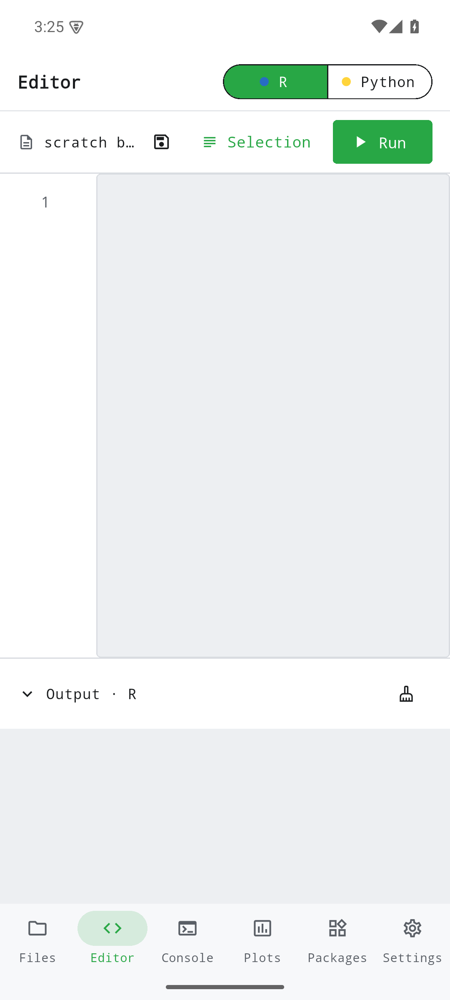
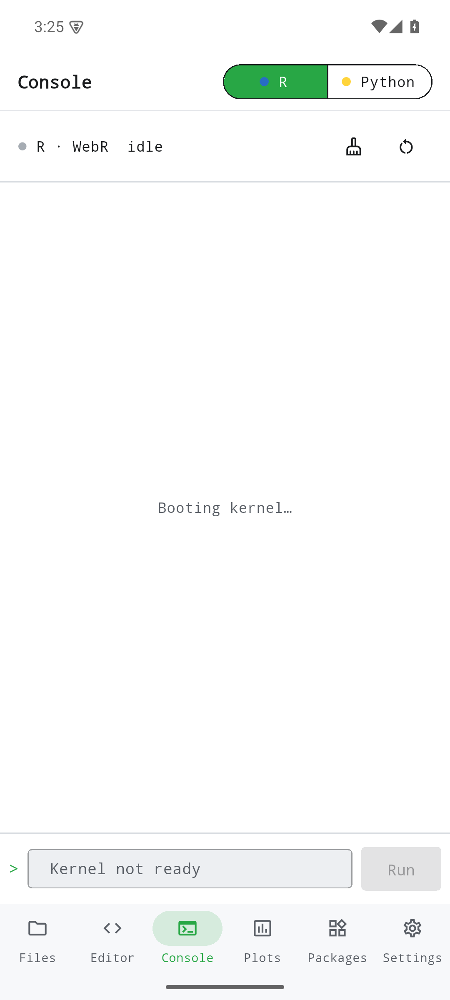
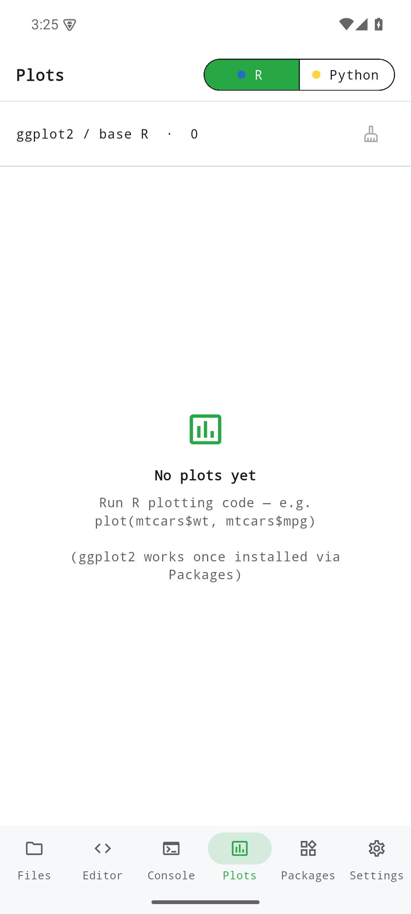
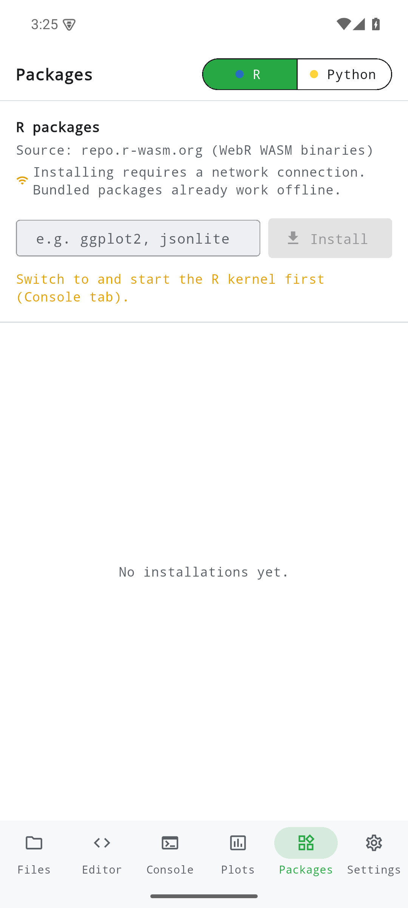
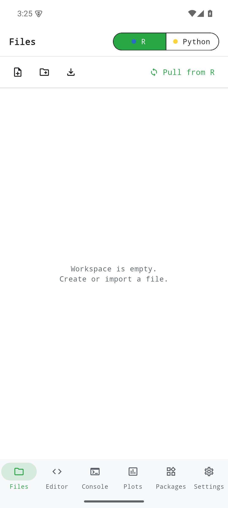
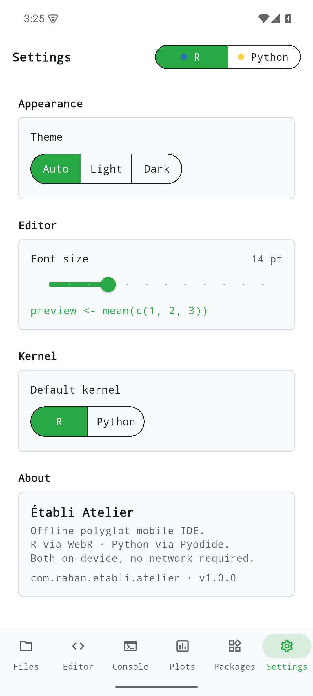

Run R and Python locally with a shared workspace, console and plots. Bundled examples run offline; extra packages and imported code may use the network.

This page describes the October 2026 source revision. These changes are unpublished and are not part of older development releases. Local checks are distinct from device, live-service and store acceptance.

[Current status / Aktueller Stand / État actuel](../current-status.qmd)

Historical screenshots from v0.1.0; these are not verification of the current revision.

{width=320}

{width=320}

{width=320}

{width=320}

{width=320}

{width=320}

{width=320}

{width=320}

{width=320}
